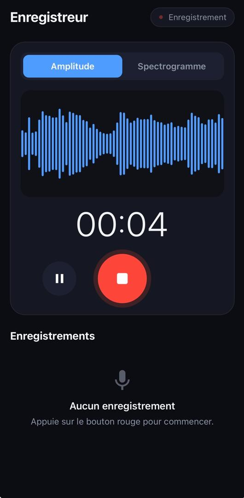
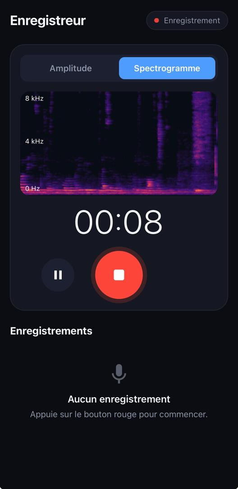
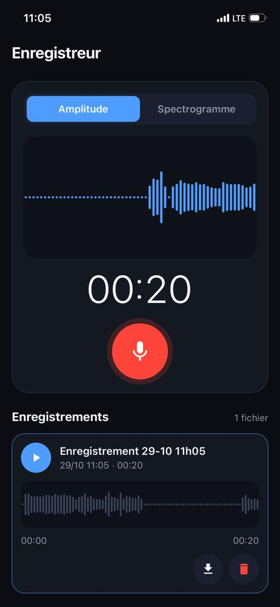

# Enregistreur audio avec visualisation en temps réel

Application mobile web (PWA) qui enregistre le son du micro et affiche en direct
l'amplitude ou un spectrogramme.

**Démo :** (https://enregistreur-audio.vercel.app)

## Captures d'écran

## Fonctionnalités

- Enregistrement avec Démarrer / Pause / Arrêter et chronomètre
- Visualisation en direct : amplitude (RMS en dB) ou spectrogramme (FFT)
- Sauvegarde locale des enregistrements (IndexedDB), liste, lecture, téléchargement
- Gestion du refus de permission du micro
- Installable sur l'écran d'accueil (PWA)

## Technologies

HTML, CSS, JavaScript (modules ES) — Web Audio API (`AnalyserNode`),
MediaRecorder, Canvas 2D, IndexedDB, Service Worker. Déploiement sur Vercel.

## Architecture

Le code est découpé en modules, chacun avec une seule responsabilité.

| Fichier | Rôle |
|---|---|
| `js/main.js` | Point d'entrée : relie les modules entre eux |
| `js/recorder.js` | Micro, Web Audio, pause/arrêt, mesure du niveau sonore |
| `js/visualizer.js` | Graphique en direct (amplitude ou spectrogramme) |
| `js/spectrogram.js` | Calcul et couleurs du spectrogramme |
| `js/draw.js` | Outils de dessin sur canvas |
| `js/library.js` | Liste des enregistrements et lecteur |
| `js/storage.js` | Sauvegarde dans IndexedDB |
| `js/ui.js` | Boutons, chronomètre, messages |
| `js/config.js`, `js/icons.js`, `js/utils.js` | Constantes, icônes, fonctions utilitaires |

Pipeline : micro → permission → flux audio → analyse (RMS ou FFT) →
dessin sur canvas, et en parallèle écriture du fichier audio → sauvegarde → lecture.

`recorder.js` ne connaît pas l'interface : il émet des événements
(`start`, `state`, `finish`, `error`) que `main.js` relie au reste.

## Lancer en local

1. Cloner le dépôt.
2. Ouvrir le dossier dans VS Code avec l'extension **Live Server**.
3. Cliquer sur **Go Live** : la page s'ouvre sur `http://127.0.0.1:5500`.

Le micro ne fonctionne que sur `localhost` ou en HTTPS. Ouvrir `index.html`
directement par double-clic ne marche pas (modules ES).